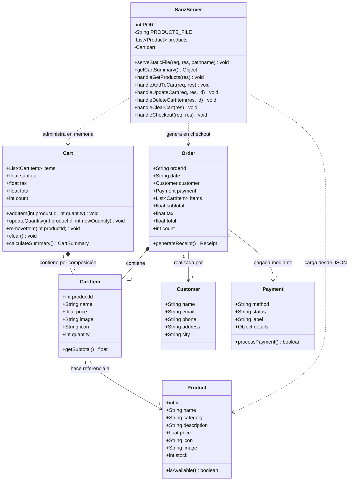
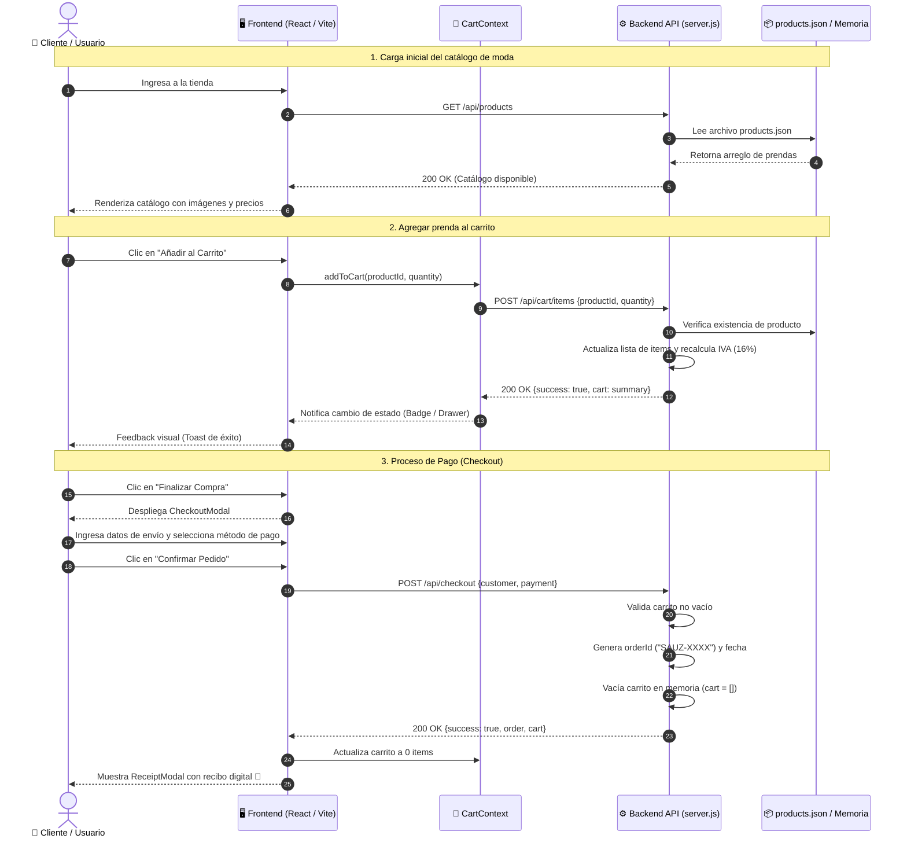
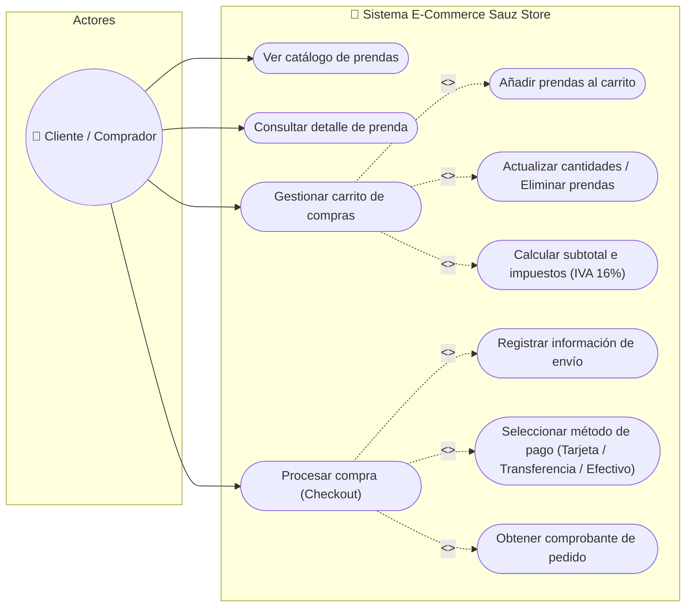
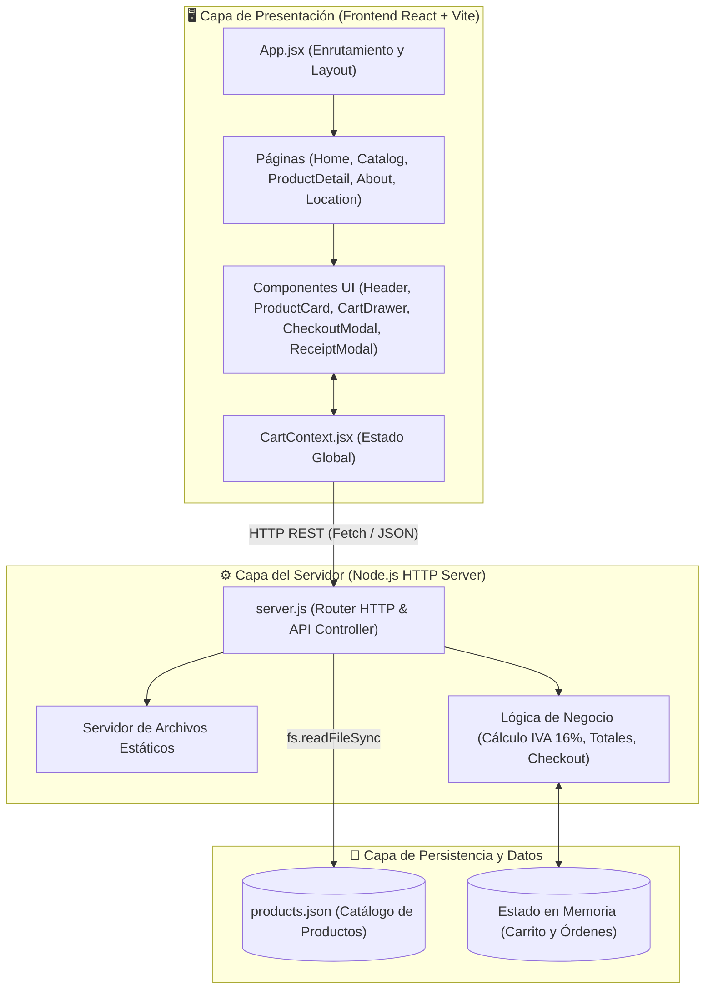

# 📊 Diagramas UML y Arquitectura del Sistema - Sauz Store

Documento técnico y visual del sistema de comercio electrónico **Sauz Store**, diseñado para exposición académica y técnica.

---

## 1. Diagrama de Clases UML (Estructura de Datos y Negocio)

Este diagrama modela las entidades del sistema, sus atributos con tipos de datos, visibilidad (`+` público, `-` privado), métodos y relaciones de agregación (`*--`), asociación (`-->`) y dependencia (`..>`).

---

## 2. Diagrama de Secuencia UML (Flujo de Compra y Checkout)

Muestra la interacción dinámica paso a paso en el tiempo entre el Cliente, el Frontend (React), el Contexto de estado, el Backend (Node.js) y la Capa de Datos (JSON / Memoria).

---

## 3. Diagrama de Casos de Uso UML

Modela las funcionalidades del sistema desde la perspectiva del actor (Cliente / Comprador).

---

## 4. Diagrama de Arquitectura de Componentes

Muestra cómo interactúan las capas de presentación, lógica de negocio y persistencia.

---

## 5. Guion Rápido para Exponer (Puntos Clave)

1. **Introducción:**
   > *"Buenos días / tardes. Presento la arquitectura de **Sauz Store**, una plataforma de comercio electrónico de moda urbana desarrollada con una arquitectura Cliente-Servidor desacoplada."*

2. **Diagrama de Clases:**
   > *"En nuestro diagrama de clases destacamos la entidad `Product`, la cual alimenta al `CartItem`. La clase `Cart` maneja una relación de composición fuerte con sus items y se encarga del cálculo automático de subtotales e IVA del 16%. Al procesar la compra, la clase `Order` encapsula el cliente (`Customer`), la forma de pago (`Payment`) y la lista de productos adquiridos."*

3. **Diagrama de Secuencia:**
   > *"El diagrama de secuencia describe el ciclo de vida de una compra: primero la consulta asíncrona del catálogo de productos vía `GET /api/products`; segundo, la actualización reactiva del carrito mediante `POST /api/cart/items`; y finalmente, la transacción atómica de checkout vía `POST /api/checkout`, la cual genera un identificador único de orden (`SAUZ-XXXX`) y resetea el carrito."*

4. **Diagrama de Casos de Uso:**
   > *"El actor principal es el Cliente. Las funcionalidades nucleares son la exploración de prendas, la administración reactiva del carrito y la pasarela de compra, con relaciones de inclusión (`<<include>>`) para garantizar que la orden siempre valide el pago y los datos de envío."*

