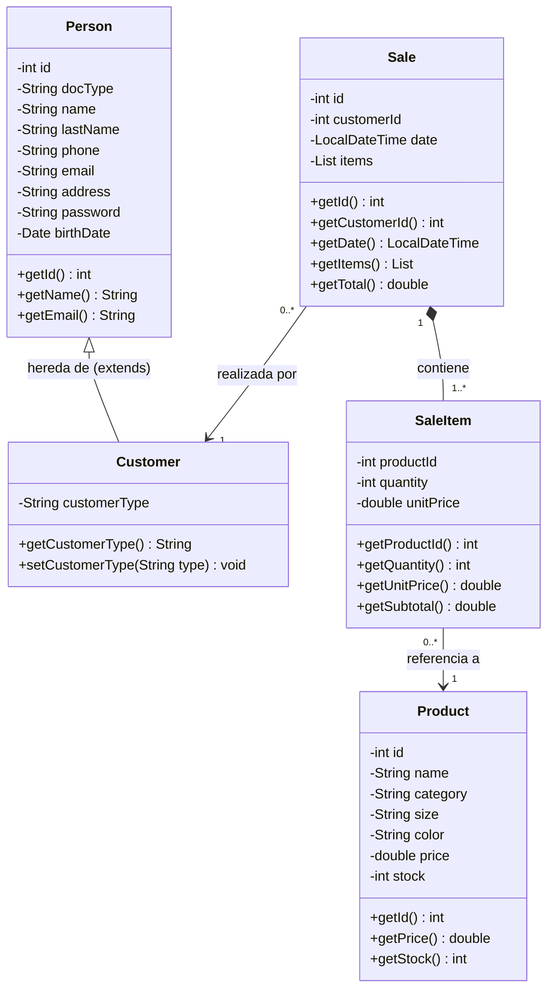
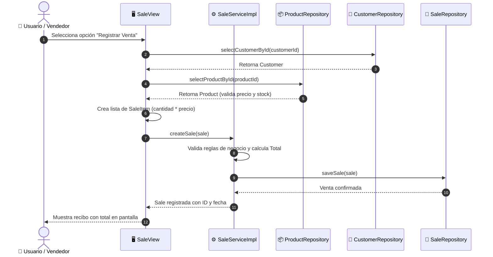

# 📊 Diagramas UML y Arquitectura del Sistema - Sauz Store (Java & Arquitectura Hexagonal)

Documento técnico y visual del sistema backend oficial en **Java 17 (Maven, Arquitectura Hexagonal y POO)** para **Sauz Store**.

---

## 1. Diagrama de Clases UML (Modelo de Dominio Java)

Este diagrama representa fielmente las clases POO del paquete `app.domain` en Java:



---

## 2. Diagrama de Arquitectura Hexagonal (Puertos y Adaptadores)

Estructura por capas implementada en `backend/src/main/java/app/`:

```mermaid
flowchart TD
    subgraph UI ["🖥️ Capa de Presentación / Adaptador Primario (app.view / userinterface)"]
        UserInterface["UserInterface.java (Menú Consola)"]
        CustomerView["CustomerView.java"]
        ProductView["ProductView.java"]
        SaleView["SaleView.java"]
        UserInterface --> CustomerView
        UserInterface --> ProductView
        UserInterface --> SaleView
    end

    subgraph PuertosEntrada ["🔌 Puertos de Entrada (app.service.inputport)"]
        CustomerService["<<interface>> CustomerService"]
        ProductService["<<interface>> ProductService"]
        SaleService["<<interface>> SaleService"]
    end

    subgraph Servicios ["⚙️ Lógica de Negocio (app.service)"]
        CustomerServiceImpl["CustomerServiceImpl.java"]
        ProductServiceImpl["ProductServiceImpl.java"]
        SaleServiceImpl["SaleServiceImpl.java"]
    end

    subgraph Dominio ["💎 Núcleo de Dominio POO (app.domain)"]
        Person["Person.java"]
        Customer["Customer.java (extends Person)"]
        Product["Product.java"]
        Sale["Sale.java"]
        SaleItem["SaleItem.java"]
        Person <|-- Customer
        Sale *-- SaleItem
    end

    subgraph PuertosSalida ["🔌 Puertos de Salida (app.service.outputport)"]
        CustomerRepo["<<interface>> CustomerRepository"]
        ProductRepo["<<interface>> ProductRepository"]
        SaleRepo["<<interface>> SaleRepository"]
    end

    subgraph Infraestructura ["💾 Capa de Persistencia / Adaptador Secundario (app.repository)"]
        CustomerRepoImpl["CustomerRepositoryImpl.java (H2 Database)"]
        ProductRepoImpl["ProductRepositoryImpl.java (H2 Database)"]
        SaleRepoImpl["SaleRepositoryImpl.java (H2 Database)"]
    end

    UI --> PuertosEntrada
    PuertosEntrada -.-> Servicios
    Servicios --> Dominio
    Servicios --> PuertosSalida
    PuertosSalida -.-> Infraestructura
```

---

## 3. Diagrama de Secuencia (Registrar Venta en Java)



---

## 4. Guion Rápido para Exponer ante el Profesor

1. **Introducción:**
   > *"Buenas tardes profesor. Nuestro backend está desarrollado en **Java 17 con Maven** bajo el patrón de **Arquitectura Hexagonal (Puertos y Adaptadores)** y principios puros de **Programación Orientada a Objetos**."*

2. **Herencia y Polimorfismo:**
   > *"En el paquete `app.domain`, implementamos herencia directa: la clase `Customer` hereda de la clase base `Person` (`public class Customer extends Person`), reutilizando atributos como documento, nombre, teléfono y dirección, y añadiendo el atributo especializado `customerType`."*

3. **Composición y Reglas de Negocio:**
   > *"La clase `Sale` tiene una relación de composición con `SaleItem`. La venta es responsable de calcular el total sumando los subtotales de cada ítem (`items.stream().mapToDouble(SaleItem::getSubtotal).sum()`)."*

4. **Arquitectura Hexagonal (Desacoplamiento):**
   > *"El dominio y la lógica de negocio no dependen directamente de la base de datos ni de la consola. La comunicación se realiza mediante interfaces: puertos de entrada (`CustomerService`, `ProductService`, `SaleService`) y puertos de salida (`CustomerRepository`, etc.), permitiendo que la persistencia en H2 pueda ser cambiada sin alterar el código de negocio."*
